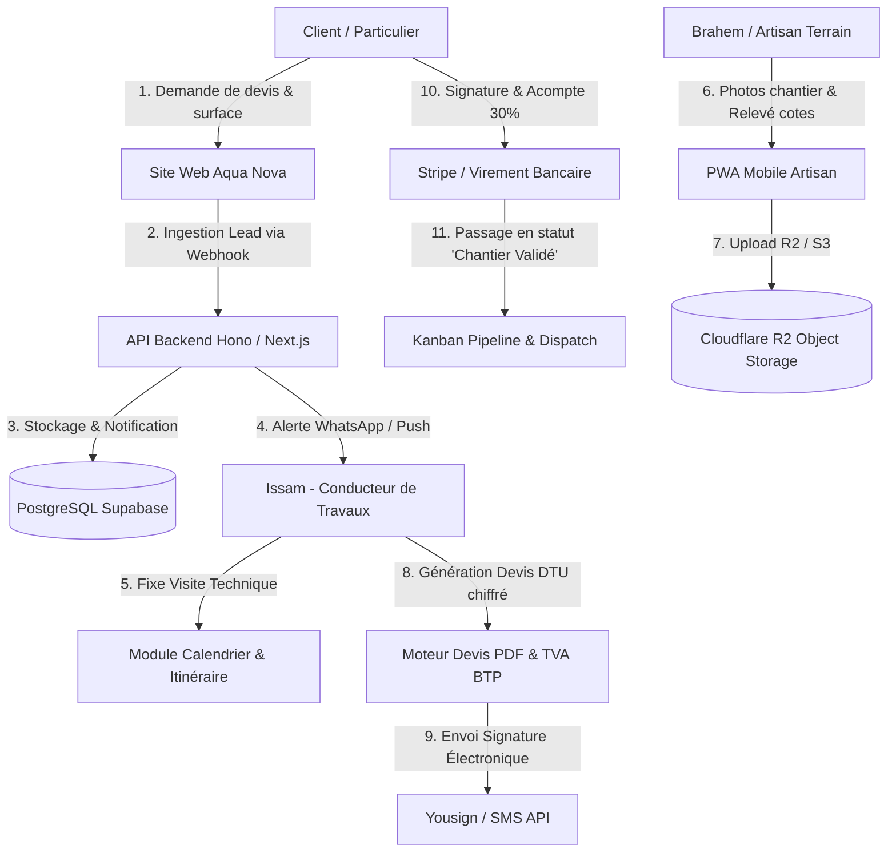

# 🏗️ AquaNova CRM — Cahier des Charges & Architecture Logicielle
## Système de Gestion Opérationnelle Dédié à la Rénovation Haut de Gamme & Plomberie d'Art

> **Version** : 1.0.0 (Master Architecture Plan)  
> **Auteur** : Mohamed Slimani / Stepping Stones Agency  
> **Cible** : Entreprises artisanales du bâtiment (BTP), plomberie d'exception, staffeurs/plaquistes et rénovateurs tout corps d'état (TCE).

---

## 1. 🎯 Analyse du Marché & Spécificités de la Niche

Dans le secteur de la rénovation de prestige et de la plomberie d'art (salles de bain marbre, réseaux cuivre encastrés, faux plafonds LED), les CRM généralistes (HubSpot, Salesforce, Pipedrive) échouent car ils ignorent les contraintes fondamentales du BTP :

1. **La Visite Technique sur Place** : Un projet ne se conclut jamais sans un diagnostic terrain (pression d'eau, évacuations, état des colonnes, hauteur sous plafond, accès au compteur).
2. **La Structure Légale des Devis BTP (Normes DTU)** :
   * Ventilation obligatoire : **Main d'Œuvre** vs **Fournitures**.
   * Régimes de TVA multiples : **5,5%** (rénovation énergétique), **10%** (logement > 2 ans), **20%** (neuf, luxe et électroménager).
   * Mentions obligatoires de l'assurance décennale (nom de l'assureur, numéro de police, zone géographique couverte).
3. **Le Suivi Photographique & La Protection Juridique** : Besoin d'immortaliser les étapes invisibles (étanchéité sous carrelage SEL, passage des gaines, tests de pression hydrostatique) pour parer à tout litige avec les assurances ou syndics de copropriété.
4. **La Réception de Chantier (PV)** : Étape contractuelle clé qui déclenche l'émission de la facture de solde et le point de départ de la garantie décennale (10 ans).

---

## 2. 🏛️ Schéma d'Architecture & Flux de Données



---

## 3. 🧩 Modules Fonctionnels du CRM

### Module A — Ingestion & Qualification des Leads
* **Capture omnicanale** : Formulaires web (simulateur interactif), appels téléphoniques, courriels, recommandations d'architectes d'intérieur.
* **Score de maturité du projet** : Budget estimé, délai d'intervention souhaité, disponibilité immédiate des fonds ou financement bancaire.
* **Planification de la visite technique** : Intégration Google Maps / Waze pour calculer les tournées des artisans selon les zones géographiques.

### Module B — Générateur de Devis BTP & Bibliothèque d'Ouvrages
* **Bibliothèque préconfigurée par corps d'état** :
  * *Plomberie* : Mètre linéaire de cuivre serti, receveur douche italienne, robinet encastré, raccordement nourrice.
  * *Plâtrerie* : M² de cloison BA13 phonique, m² de faux plafond suspendu, mètre linéaire de gorge lumineuse LED.
  * *Carrelage / Marbrerie* : Pose au m² marbre grand format, étanchéité liquide SEL, ragréage fibré.
* **Calcul automatique des marges et du coefficient de frais généraux**.
* **Ventilation automatique des taux de TVA (10% et 20%)**.
* **Échéancier de paiement contractuel** :
  * 30% à la signature de l'ordre de service (réservation des artisans et commande matériaux).
  * 40% à l'achèvement des réseaux et de l'étanchéité.
  * 30% à la signature du procès-verbal de réception.

### Module C — Dispatching des Artisans & Planning Kanban
* **Kanban des chantiers en 5 colonnes** :
  1. *Visite Technique Programmée*
  2. *Devis Transmis / En Négociation*
  3. *Chantier Approvisionné (Matériaux en stock)*
  4. *Travaux en Cours d'Exécution*
  5. *Réceptionné & Garanti Décennale*
* **Assignation par artisan titulaire** :
  * Brahem (Génie Sanitaire & Plomberie)
  * Ibrahim (Plâtrerie, Staff & Acoustique)
  * Issam (Coordination TCE & Achats)

### Module D — Journal de Chantier & Espace Client Dédié
* **Lien magique privé (WhatsApp / SMS)** : Le client accède en un clic à une page sécurisée sans mot de passe affichant :
  * Le planning d'avancement au jour le jour.
  * Le journal photo quotidien (validation des étapes invisibles).
  * Les documents administratifs (Attestation décennale Allianz, plans 3D, factures acquittées).
* **Communication bilatérale** : Possibilité pour le client de valider un choix de finition ou un échantillon de marbre directement depuis son smartphone.

### Module E — Réception de Chantier & Gestion des Litiges
* **Générateur de PV de réception (conforme NF P 03-001)** avec signature manuscrite sur tablette.
* **Horodatage cryptographique et géolocalisation** des photos de livraison.
* **Archivage décennal sécurisé** (10 ans) pour activation immédiate en cas de recours d'assurance.

---

## 4. 🗄️ Modèle de Données Relationnel (PostgreSQL)

```sql
-- Clients & Maîtres d'Ouvrage
CREATE TABLE clients (
    id UUID PRIMARY KEY DEFAULT gen_random_uuid(),
    first_name VARCHAR(100) NOT NULL,
    last_name VARCHAR(100) NOT NULL,
    email VARCHAR(255) UNIQUE NOT NULL,
    phone VARCHAR(30) NOT NULL,
    address TEXT NOT NULL,
    postal_code VARCHAR(10) NOT NULL,
    city VARCHAR(100) NOT NULL,
    access_code TEXT, -- Digicode, étage, ascenseur
    created_at TIMESTAMP WITH TIME ZONE DEFAULT NOW()
);

-- Chantiers / Sites
CREATE TABLE projects (
    id UUID PRIMARY KEY DEFAULT gen_random_uuid(),
    client_id UUID REFERENCES clients(id) ON DELETE CASCADE,
    title VARCHAR(255) NOT NULL,
    category VARCHAR(50) NOT NULL, -- 'bathroom', 'plumbing', 'plaster', 'turnkey'
    status VARCHAR(50) NOT NULL DEFAULT 'lead', 
    budget_estimated DECIMAL(12, 2),
    surface_m2 INT,
    assigned_manager UUID, -- Issam
    start_date DATE,
    target_delivery_date DATE,
    actual_delivery_date DATE,
    decennial_policy_number VARCHAR(100) DEFAULT 'AZ-98421-DEC',
    created_at TIMESTAMP WITH TIME ZONE DEFAULT NOW()
);

-- Devis & Lignes d'Ouvrages
CREATE TABLE quotes (
    id UUID PRIMARY KEY DEFAULT gen_random_uuid(),
    project_id UUID REFERENCES projects(id) ON DELETE CASCADE,
    reference VARCHAR(50) UNIQUE NOT NULL, -- 'DEV-2026-001'
    status VARCHAR(30) DEFAULT 'draft', -- 'sent', 'signed', 'rejected'
    total_labor_ht DECIMAL(12, 2) NOT NULL DEFAULT 0,
    total_materials_ht DECIMAL(12, 2) NOT NULL DEFAULT 0,
    vat_10_amount DECIMAL(12, 2) NOT NULL DEFAULT 0,
    vat_20_amount DECIMAL(12, 2) NOT NULL DEFAULT 0,
    total_ttc DECIMAL(12, 2) NOT NULL DEFAULT 0,
    signed_at TIMESTAMP WITH TIME ZONE,
    signature_ip VARCHAR(50)
);

CREATE TABLE quote_items (
    id UUID PRIMARY KEY DEFAULT gen_random_uuid(),
    quote_id UUID REFERENCES quotes(id) ON DELETE CASCADE,
    work_category VARCHAR(50), -- 'plomberie', 'platrerie', etc.
    description TEXT NOT NULL,
    materials_cost_ht DECIMAL(10, 2) DEFAULT 0,
    labor_cost_ht DECIMAL(10, 2) DEFAULT 0,
    vat_rate DECIMAL(4, 2) DEFAULT 10.00
);

-- Journal de Chantier & Photos Terrain
CREATE TABLE site_logs (
    id UUID PRIMARY KEY DEFAULT gen_random_uuid(),
    project_id UUID REFERENCES projects(id) ON DELETE CASCADE,
    author_name VARCHAR(100) NOT NULL, -- 'Brahem', 'Ibrahim'
    log_text TEXT NOT NULL,
    photo_urls TEXT[], -- URLs stockées sur S3 / R2
    is_client_visible BOOLEAN DEFAULT TRUE,
    created_at TIMESTAMP WITH TIME ZONE DEFAULT NOW()
);
```

---

## 5. 🛠️ Stack Technique Recommandée

* **Frontend Web & Tablette** : React 19 + Next.js 15 (App Router) + Tailwind CSS v4 + Framer Motion.
* **Composants d'Interface** : Cult UI + Magic UI rethémés en *Quiet Luxury* (tons or, void et surface).
* **Backend API** : Routeurs Hono ou Next.js Server Actions ultra-rapides typés via TypeScript strict & Zod.
* **Base de Données** : PostgreSQL hébergé sur Supabase (avec RLS - Row Level Security).
* **Stockage Médias (Photos de chantier HD)** : Cloudflare R2 (zéro frais d'egress).
* **Moteur PDF** : `@react-pdf/renderer` pour générer des devis et PV de réception à la volée.
* **Notifications & SMS** : Twilio API (alertes SMS d'arrivée artisan) + SendGrid (devis PDF).

---

## 6. 📅 Feuille de Route de Déploiement

| Phase | Durée | Livrables Principaux |
| :--- | :--- | :--- |
| **Phase 1 : MVP Core** | Semaines 1 à 3 | Ingestion des leads, Pipeline Kanban et Générateur de devis BTP avec ventilation TVA. |
| **Phase 2 : PWA Mobile** | Semaines 4 à 6 | Interface mobile pour Brahem et Ibrahim : prise de photos géolocalisées et signature sur écran. |
| **Phase 3 : Espace Client** | Semaines 7 à 8 | Portail client avec lien magique WhatsApp, suivi du journal de chantier et attestations d'assurance. |
| **Phase 4 : Achats & Décennale** | Semaines 9 à 10 | Rapprochement des bons de commande fournisseurs (Grohe, Marbre) et coffre-fort décennal 10 ans. |

---

<p align="center">
  Document validé pour exécution immédiate • Stepping Stones Agency
</p>
