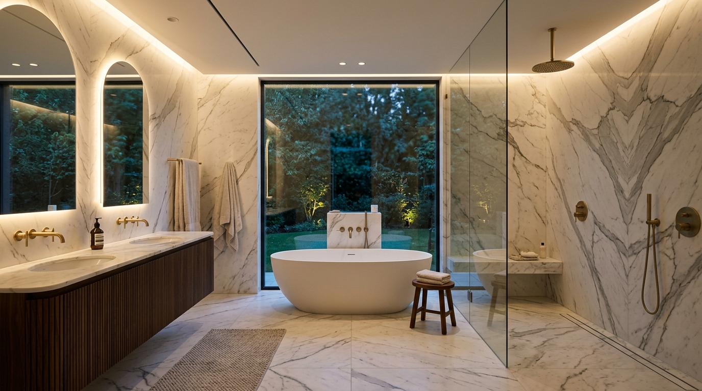

# 💎 Aqua Nova — Plomberie d'Exception & Rénovation Haut de Gamme



[](LICENSE)
[](#-design-system--direction-artistique)
[](#-performance--accessibilité)
[](#)

> **Aqua Nova** est la vitrine digitale d'une entreprise artisanale haut de gamme spécialisée dans la création de salles de bain sur-mesure en marbre, le génie hydraulique et sanitaire de précision, la plâtrerie architecturale et la rénovation globale clé en main.

---

## 🏛️ Vue d'Ensemble & Positionnement

Conçu selon la doctrine **Quiet Luxury** (élégance minérale, contrastes abyssaux, touches d'or noble et typographies éditoriales), le site offre une expérience utilisateur fluide, immersive et ultra-réactive, tout en mettant en valeur le savoir-faire des maîtres artisans de l'équipe :

* **Brahem** — *Maître Artisan Plombier & Chauffagiste* : Réseaux hydrauliques haute pression en cuivre et multicouche serti, planchers chauffants basse température et installations sanitaires de prestige.
* **Ibrahim** — *Artisan Staffeur & Plaquiste* : Ouvrages soignés en plaques de plâtre, plafonds suspendus décoratifs avec gorges lumineuses LED indirectes et isolation thermo-acoustique.
* **Issam** — *Coordinateur de Chantier TCE* : Pilotage opérationnel, respect strict des délais et conformité aux normes DTU pour des projets livrés sans compromis.

---

## ✨ Fonctionnalités Clés

* **Calculateur de Devis Interactif** :
  Estimation budgétaire instantanée en fonction de la typologie de travaux (salle de bain, plomberie, plâtrerie, rénovation globale), de la surface ($m^2$) et du niveau de finition (*Prestige*, *Haute Couture*, *Signature Architecte*). Transfert automatique des paramètres dans le formulaire de contact.
* **Portfolio Filtrable avec Modal Lightbox** :
  Galerie de réalisations haute définition avec filtrage dynamique par corps d'état et zoom plein écran haute résolution.
* **Navigation Fluide & Sticky Header Glassmorphic** :
  Barre de navigation fixe avec effet de flou d'arrière-plan (*backdrop-blur*), détection dynamique de la section active sur le scroll et menu mobile rétractable.
* **Compteurs Métriques Animés** :
  Affichage dynamique des statistiques clés (20+ années d'expérience, 350+ projets conduits, garantie décennale 10 ans) activé via `IntersectionObserver`.
* **Formulaire de Contact Sécurisé & Notifications Toast** :
  Validation côté client sans rechargement de page, piège anti-spam (*honeypot*), état de chargement et notification toast flottante.
* **Foire Aux Questions (FAQ) Accordéon** :
  Réponses claires et interactives sur les garanties, délais et modalités d'intervention.

---

## 🎨 Design System & Direction Artistique

Le projet applique les tokens stricts du design d'exception :

```css
--bg-void:       #060610; /* Fond abyssal */
--bg-primary:    #0a0a16; /* Fond principal */
--bg-surface:    #0f1024; /* Cartes & containers */
--bg-elevated:   #151630; /* Popovers & modals */

--gold-500:      #c5a059; /* Or signature Quiet Luxury */
--gold-400:      #e8c77a; /* Or lumineux / hover */
--gold-glow:     rgba(197, 160, 89, 0.16);

--text-primary:  #f5f3ef; /* Blanc chaud minéral */
--text-secondary: rgba(245, 243, 239, 0.72);
```

### Typographies
* **Titres & Display** : `Cormorant Garamond` (élégance classique, serif noble)
* **Corps & UI** : `Outfit` (lisibilité contemporaine)
* **Métriques & Chiffres** : `JetBrains Mono` (précision technique & tabulaire)

---

## 📁 Architecture du Projet

```
AquaNova2/
├── .github/
│   └── workflows/
│       └── deploy.yml          # Déploiement automatisé GitHub Pages
├── assets/
│   ├── fonts/                  # Sentinelle typographies locales
│   ├── icons/                  # Sentinelle icônes vectorielles
│   ├── images/                 # Photographies HD de l'équipe et des ouvrages
│   │   ├── Brahem.jpg          # Maître Artisan Plombier
│   │   ├── Ibrahim.jpg         # Artisan Plaquiste & Staffeur
│   │   ├── Issam.jpg           # Coordinateur de Chantier
│   │   ├── hero-img.jpg        # Visuel bannière principale
│   │   ├── logo.svg            # Logo vectoriel officiel
│   │   └── img1.jpg à img4.jpg # Réalisations du portfolio
│   └── scss/
│       └── custom.scss         # Source SCSS optionnelle
├── images/                     # Assets optimisés pour le web
│   ├── logo.png                # Logo haute résolution
│   ├── hero-img.png            # Visuel hero plein format
│   └── img1.png à img4.png     # Projets de la galerie
├── favicon.svg                 # Icône de navigateur vectorielle
├── index.html                  # Structure sémantique HTML5 complète
├── styles.css                  # Feuille de style Quiet Luxury
├── script.js                   # Moteur interactif Vanilla JS
├── package.json                # Scripts npm et métadonnées
├── .gitignore                  # Exclusion des dépendances et caches
└── LICENSE                     # Licence MIT
```

---

## 🚀 Démarrage Rapide

### Prérequis
* Node.js (v18+) ou n'importe quel serveur HTTP statique (Python, Live Server, etc.)

### 1. Cloner le Dépôt
```bash
git clone https://github.com/mohslimm/aquanova.git
cd aquanova
```

### 2. Lancer en Local
```bash
# Avec npm (utilise npx serve)
npm start

# Ou avec Python
python -m http.server 3000
```
Ouvrez ensuite votre navigateur sur `http://localhost:3000`.

---

## 🌐 Déploiement sur GitHub Pages

Le projet est entièrement statique et optimisé pour un hébergement instantané sur **GitHub Pages** :
1. Accédez aux **Settings** du dépôt GitHub.
2. Dans la section **Pages**, choisissez la source : `Deploy from a branch`.
3. Sélectionnez la branche `main` et le dossier `/ (root)`.
4. Le site sera disponible en quelques secondes avec HTTPS actif.

---

## 🛡️ Qualité & Performance

* **Zéro Dépendance Runtime Lourde** : Le moteur fonctionne en JavaScript vanilla ultra-performant.
* **Responsive Mobile-First** : Adaptabilité complète de 375px (iPhone SE) à 2560px (écrans 4K).
* **Accessibilité WCAG AA** : Contrastes vérifiés, attributs ARIA complets et navigation au clavier.

---

## 📄 Licence

Ce projet est sous licence **MIT** — voir le fichier [LICENSE](LICENSE) pour plus de détails.

---

<p align="center">
  Développé avec passion pour <strong>Aqua Nova</strong> • Standard d'Excellence Stepping Stones Agency
</p>
